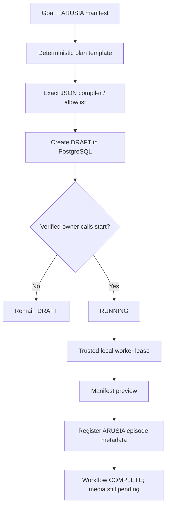

# IM19 Autonomous Workflow Engine v9.2–v9.3 (staging foundation)

**Implemented:** allowlisted deterministic planner, fail-closed workflow compiler,
owner-scoped durable PostgreSQL DAG, explicit start/pause/resume/cancel, CAS
leases, retry budget, bounded backoff, and a supervised local worker CLI.

**Not implemented:** general LLM planning, arbitrary plugin calls, unattended
AI task generation, media generation, browser automation, remote authenticated
worker registration, automatic creative approval, Google Drive upload or MP4
rendering. This initial engine performs only two locally allowlisted operations:
`arusia.manifest_preview` and `arusia.episode_register`.

## Execution contract



The planner accepts only the goal `prepare_arusia_episode` (also
`siapkan episode arusia` or `prepare arusia episode`). It validates
`arusia.v9.0` shot manifests and emits a canonical plan containing exactly
two nodes with a verified dependency. Any alternate operations, URLs,
arbitrary commands, changed node arguments, or changed DAG topology are
rejected. A future AI model may *propose* plans, but cannot bypass this
compiler. Current planning is **template-driven, not LLM reasoning**.

Creating a plan does not execute it. The authenticated owner must invoke
`im19_workflow_start` as a separate tool call. A local worker under a
restricted OS/service principal then advances the persisted workflow.
The worker runs without requiring ChatGPT to remain connected.

## MCP tool contracts

- `im19_workflow_plan(goal, manifest_json)`
- `im19_workflow_validate(plan_json)`
- `im19_workflow_create(plan_json)`
- `im19_workflow_start(run_id)`
- `im19_workflow_status(run_id)`
- `im19_workflow_pause(run_id)`
- `im19_workflow_resume(run_id)`
- `im19_workflow_cancel(run_id)`

The first two are read-only planners/validators. All mutations require the
verified current MCP owner, `IM19_ENABLE_AUTONOMOUS_WORKFLOWS=true` and
`IM19_ENABLE_ARUSIA_WORKFLOWS=true`. They do not give the MCP client any
general shell, provider access or worker lease token.

## Local trusted worker

After updating the staging DB through `0009_autonomous_workflow`, running a
controlled migration, and configuring the IM19 vault:

```bash
export IM19_ENABLE_ARUSIA_WORKFLOWS=true
export IM19_ENABLE_AUTONOMOUS_WORKFLOWS=true

# Only on a secured host/service account; these vars are *not* IAM.
export IM19_AUTONOMY_OPERATOR_ACK=YES
export IM19_AUTONOMY_SCOPED_SUBJECT='<VERIFIED_MCP_SUBJECT>'

# Once for a single pending job, or use --loop with systemd/supervisor:
im19-autonomy-worker --run-id '<RUN_ID>' \
  --subject '<VERIFIED_MCP_SUBJECT>'

im19-autonomy-worker --run-id '<RUN_ID>' \
  --subject '<VERIFIED_MCP_SUBJECT>' --loop --interval 3
```

Use a restricted persistent service manager for `--loop` and arrange secure
secrets injection; free Colab and Codespaces sessions are **not** guaranteed
24/7 schedulers. Never expose this CLI or the database directly as an MCP tool.
If the process dies, step state remains in PostgreSQL. Once an expired lease
becomes available again, a restarted worker can claim it. Retry attempts are
bounded (3); terminal failures require an explicit new workflow/review.

The worker's currently allowlisted activities are metadata-only and
idempotent. Do not add remote provider mutation to an automatic retry loop:
provider write operations need independent approval and reconciliation of
unknown outcomes.

## Deployment dependencies

This branch builds on the ARUSIA v9.1 branch from PR #16 because the
historical PR #16 merge was made into PR #15's branch, and the ARUSIA files
were not available in `main` when this work started. Do **not** deploy only
this migration against the current main checkout.

Migration chain: `0006_write_approvals` →
`0007_arusia_workflow` → `0008_arusia_artifacts` →
`0009_autonomous_workflow`.

Both feature flags are **disabled by default**, including in Codespaces.
Tests cover plan tampering, owner isolation, explicit start, pause/resume,
cancellation, stale lease recovery, exhausted lease failure and MCP tools.

## Next acceptance gates

1. Land all ARUSIA migrations on `main` after a reviewed integration PR.
2. Add a first-party worker registry and authenticated remote worker transport
   (mTLS or short-lived scoped credentials) with heartbeat/reconciliation.
3. Extend the compiler's allowlist to ComfyUI/Blender/FFmpeg task contracts.
   Validate input assets, output bytes and quality before unlocking successors.
4. Add true LLM planner **behind** the exact compiler, budget controls, manual
   creative approvals and model/seed/reference provenance.
5. Prove one 5-second Kio shot using genuine assets and playable MP4.
